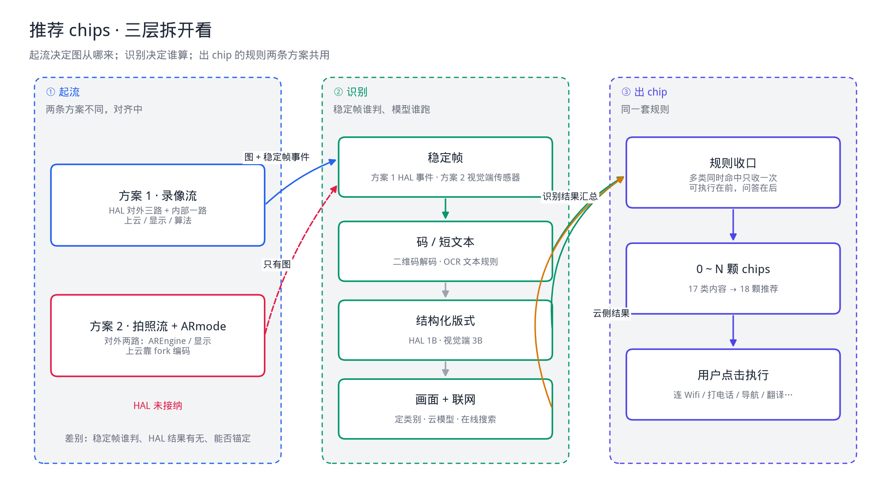
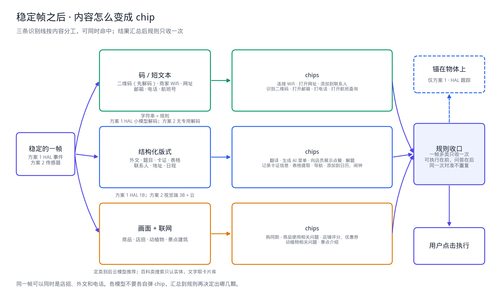
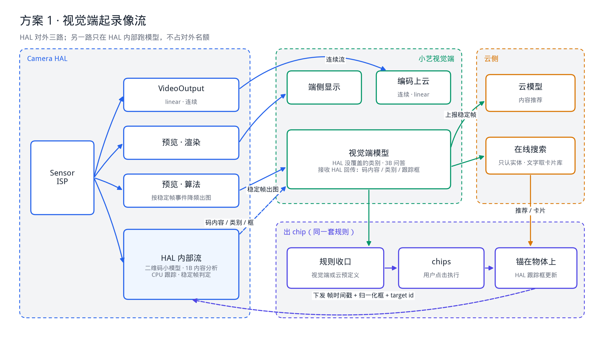
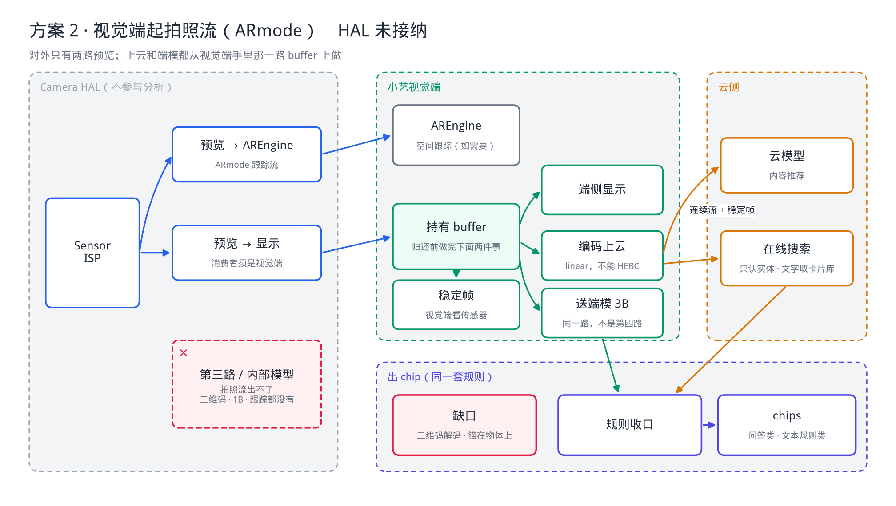
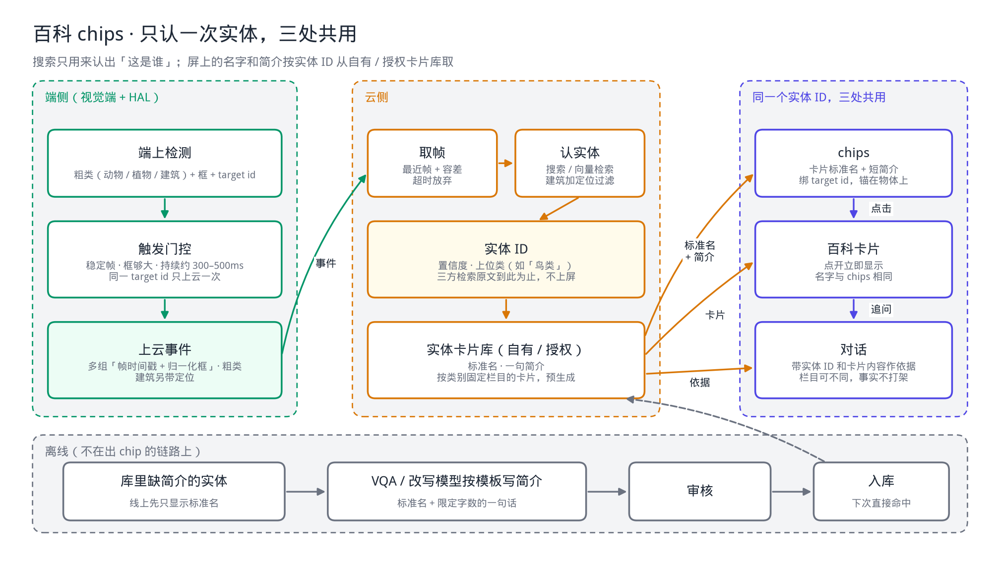
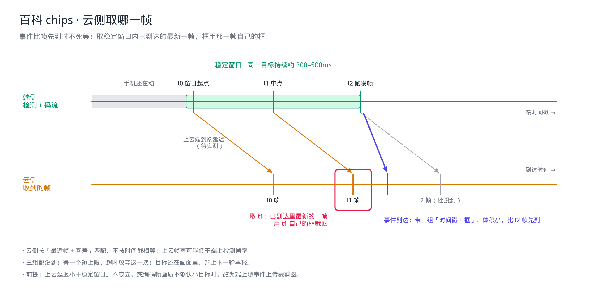

# 小艺视觉端 · 推荐 chips 方案

> 用途：把「起流 / 谁识别 / 出什么 chip」拆开，和 HAL、云侧对齐。  
> 状态：讨论稿。方案 1 在对齐；方案 2 HAL 未接纳。  
> 范围：小艺视觉端（原相机小艺 Tab）的内容推荐 chips。不含拍摄取片、深度。  
> 百科 chips（动植物、建筑）的实体卡片库链路、取帧和业界对照在第 6 节。

---

## 0. 三层分开看



信息乱，是因为三层叠在一张图上。

| 层 | 决定什么 | 两条方案是否相同 |
|---|---|---|
| 起流 | 图从哪来、上云编码谁出、HAL 出几路 | 不同，还在对齐 |
| 识别 | 稳定帧谁判、二维码 / 类别 / 跟踪谁算 | 不同 |
| 出 chip | 识别到的类别映射成哪颗推荐 | 相同 |

出 chip 只看内容类别和抽出来的文本，不看这次是录像流还是拍照流。

---

## 1. 出 chip 的共同流程



```text
稳定的一帧
    │
    ├─► 识别（可多类同时命中）
    │     码 / 短文本 ── 规则
    │     卡证表格题目外文等 ── 版式 + 模型
    │     商品店招动植物景点 ── 模型 + 云侧搜索
    │
    ▼
规则收口（视觉端或云上的预定义规则，只收一次）
    │
    ▼
0～N 颗 chips    用户点击才执行
    │
    └─► 仅方案 1：把这一帧的时间戳、框和 target id 交给 HAL，chip 锚在物体上
```

一帧可以同时是店招、外文和电话。各模型不要各自弹 chip，结果汇总后再由规则决定出哪几颗。

建议（待拍板）：能直接执行的放前面，例如识别二维码、打电话、打开网址、导航、连接 Wifi；问答和知识卡放后面。同一次对准里，同一颗 chip 不重复弹。

上云编码和云侧分析是两件事：

- 编码上云是连续流（方案 1 的 VideoOutput，方案 2 的 fork 编码）。
- 内容推荐和在线搜索由稳定帧触发，不是每帧都分析。
- 云侧用哪张图见 6.3：默认按帧时间戳从上云码流里取，取不到或画质不够时端上另传裁剪图。

---

## 2. 内容 → chip

17 类内容。商品同时对应「购同款」和「商品使用相关问题」，外文、日程、店招也是一内容多颗 chip。

### 2.1 码和短文本

抽到字符串就能定，不必为了出 chip 再跑一遍大模型。二维码先解码，再按内容落到更具体的那颗，而不是一律出「识别二维码」。

| 识别到的内容 | chip | 方案 1 | 方案 2 |
|---|---|---|---|
| 二维码，内容是 Wifi | 连接 Wifi | HAL 小模型解码 | 无专用解码，见下 |
| 二维码，内容是网址 | 打开网址 | HAL 小模型解码 | 无专用解码 |
| 二维码，内容是联系人 | 添加到联系人 | HAL 小模型解码 | 无专用解码 |
| 二维码，其他或解不出 | 识别二维码 | HAL 小模型 | 无专用解码 |
| 画面上的商家 Wifi | 连接 Wifi | 文本规则 | 文本从 3B / 云来 |
| 网址 | 打开网址 | 文本规则 | 同上 |
| 邮箱 | 打开邮箱 | 文本规则 | 同上 |
| 电话 | 打电话 | 文本规则 | 同上 |
| 航班号 | 打开航班查询 | 文本规则 | 同上 |

方案 2 的缺口在二维码解码。视觉端可以调 3B 出问答类 chips，但「图里有一个码」和「把码内容解出来」不是一回事。小艺没有二维码小模型，这颗 chip 依赖 HAL。退路是 1B / 3B 看图，解出内容没有把握。Wifi、网址、电话若是普通文字而不是码，方案 2 仍可由 OCR 文本加规则出。

### 2.2 结构化内容

要 OCR 和版式，方案 1 用 HAL 的 1B（视觉端不必对同一帧再跑一遍同类模型），方案 2 用视觉端 3B 和云分发。

| 内容 | chips |
|---|---|
| 外文 | 翻译。能看出是菜单时再加：生成 AI 菜单、向店员展示点餐 |
| 题目 | 解题 |
| 卡证 | 记录卡证信息 |
| 表格 | 表格提取 |
| 联系人 | 添加到联系人 |
| 地址 | 导航 |
| 日程 | 添加到日历、闹钟 |

### 2.3 要认画面，并联网

两条方案都把稳定帧交给云侧：云模型做内容推荐，在线搜索负责认出具体是哪个实体。方案 1 可以先用 HAL 1B 给出类别，云只补知识和搜索；方案 2 类别也由视觉端 3B 或云来出。

在线搜索的结果是三方内容，不直接显示在 chip 或卡片上。屏上的名字和简介按实体 ID 从自有或已授权的卡片库取，见第 6 节。

| 内容 | chips |
|---|---|
| 商品 | 购同款、商品使用相关问题 |
| 店招 | 店铺评分、优惠券 |
| 动植物 | 动植物相关问题 |
| 景点建筑 | 景点介绍 |

动植物和建筑在实时预览里还有一种百科形态：框出物体，旁边显示标准名和一句简介，最短只显示名字。它和上面两颗 chip 是合成一颗还是并存，待产品定。链路见第 6 节。

---

## 3. 方案 1：视觉端起录像流

HAL 对外三路，另有一路只在 HAL 内部使用，不占对外名额。



```text
视觉端起录像流
    │
    ├─ VideoOutput ─────────► 编码上云（连续，linear）
    ├─ 预览 · 渲染 ─────────► 端侧显示
    ├─ 预览 · 算法 ─────────► 按稳定帧降频出图
    │                         ├─ 视觉端模型（HAL 没覆盖的类别）
    │                         └─ 上报稳定帧到云（云模型 + 在线搜索）
    │
    └─ HAL 内部流 ──────────► 二维码、1B 内容分析、跟踪
                              结果回传视觉端，进入同一套规则
```

稳定帧由 HAL 出事件。算法那路预览按事件出图，不按预览帧率把每帧都送去模型。

跟踪不另外起流。视觉端在出 chip 时，把 HAL 打在这帧上的时间戳、归一化框（左、上、宽、高，0～1）和 target id 交给 HAL，HAL 用内部的 CPU 跟踪把框更新回去，chip 锚在物体上。识别返回时那一帧通常已经还掉了；握稳期间用这个框从当前帧开始跟。同一次对准只跟一个 target id，重新对准后换新 id。`globalMotionState` 离开脚架 / 手持稳定后，这次跟踪作废。

---

## 4. 方案 2：视觉端起拍照流（HAL 未接纳）

按 AREngine 的 ARmode 起拍照流。HAL 对外只有两路：一路预览给 AREngine，一路预览给端侧显示。没有 HAL 内部模型，也没有 HAL 稳定帧事件。



```text
视觉端起拍照流（ARmode）
    ├─ 预览 ──► AREngine
    └─ 预览 ──► 端侧显示
                │
                └─ 只有这一路的消费者是视觉端时
                   归还 buffer 之前：送端模、编码上云
```

上云不是 HAL 再出一路 VideoOutput，是视觉端从自己拿在手里的 buffer 上编码。显示若直接进渲染服务，视觉端不在队列上，这一路既不能编码上云，也不能送端模。

**不能再向 HAL fork 一路给端模。** 拍照流给不了「显示预览 + 上云录像 + 再一路算法」。端模要跑，只有两种接法：

- 显示预览的消费者就是视觉端：端模和上云编码共用这一路，在归还 buffer 之前做完。这不是第四路输出。
- 显示预览进了渲染服务：只有 AREngine 还握着图。端模要图，就得 AREngine 把帧交出来。

HAL 不参与之后，后面的流程和方案 1 的规则层相同，只是输入变了：

- 稳定帧由视觉端按传感器自己判。
- 调度视觉端 HiAI。3B 用来出问答类 chips（解题、翻译、动植物和商品相关问题等）。
- 稳定帧送到云分发：云模型做内容推荐，在线搜索认实体，卡片文字取自卡片库（第 6 节）。
- 拿不到 HAL 的二维码解码、1B 类别和跟踪框。chip 不能锚在物体上。

---

## 5. 两条方案对照

| | 方案 1 录像流 | 方案 2 拍照流 + ARmode |
|---|---|---|
| 状态 | 对齐中 | HAL 未接纳 |
| 对外出流 | VideoOutput + 显示预览 + 算法预览 | 显示预览 + AREngine 预览。上云是 fork 编码 |
| 稳定帧 | HAL 事件，算法预览按事件出图 | 视觉端看传感器 |
| 二维码 | HAL 小模型，解出内容再映射 chip | 缺口。退路是 1B / 3B 看图 |
| 版式类（卡证、表格、题目、外文等） | HAL 1B | 视觉端 3B + 云 |
| 商品、店招、动植物、景点 | HAL 1B 定类别，云补搜索和卡片 | 视觉端 3B 或云定类别，云补搜索和卡片 |
| chip 锚在物体上 | HAL 内部跟踪 | 没有 |
| 出 chip 的规则 | 同一套 | 同一套 |

---

## 6. 百科 chips（动植物、建筑）

产品形态：实时预览里检测到动植物或建筑，框出来，旁边显示名字和一句很短的简介，最短可以只显示名字。点开是百科卡片，也可以接着问。

四条结论：

- 搜索只用来认出「这是谁」，不当文字来源。三方检索结果的原文不上屏。
- 云侧把识别结果归一成一个实体 ID。名字和简介按 ID 从自有或已授权的实体卡片库取。
- 对话式 VQA 不放在出 chip 的链路上。它用在两处：离线给卡片库写简介，用户点开之后问答。
- 实体只认一次。chips、百科卡片、对话都挂在同一个实体 ID 上。

### 6.1 链路



| 步骤 | 在哪 | 做什么 |
|---|---|---|
| 检测 | 端 | 小模型（当前打算用 YOLO）出粗类（动物 / 植物 / 建筑）和框，给目标分配 target id |
| 触发 | 端 | 过门控后上报一次事件，见 6.2 |
| 取帧 | 云 | 按事件里的帧时间戳从上云码流取帧，按框裁图，见 6.3 |
| 认实体 | 云 | 搜索或向量检索，输出实体 ID、置信度、上位类（例如「鸟类」），见 6.4 |
| 取卡片 | 云 | 按实体 ID 查卡片库，取标准名和一句简介 |
| 显示 | 端 | 结果绑在 target id 上，chip 跟着框走，文字不变 |
| 点击 | 端 + 云 | 打开同一个实体 ID 的百科卡片，或带着实体 ID 进入对话 |

显示和分析是两个 Surface。显示那路由渲染服务独占，检测跑在分析那路上，可以降采样、降帧。

### 6.2 触发和去重

三条同时成立，端上才上报一次：

1. 稳定帧成立：`globalMotionState` 为 `1`（脚架）或 `2`（手持稳定），并且 `pixelShift` 的窗口中位数不超过 `T_hand`，保持约 200–300ms。不用单帧 `pixelShift` 硬切，也不用 `sceneSpeedLvl`。
2. 框够大。主体取最大、最靠近画面中心的框。面积阈值待定。
3. 同一个目标持续约 300–500ms。

事件内容：一组「帧时间戳 + 归一化框」、粗类、target id。建筑另带定位。

去重按 target id：

- 识别结果绑在 target id 上。目标还在画面里、手机没有离开稳定，就不再上云。
- 重新对准后换新的 target id，旧结果作废。
- 结果回来时这个 target id 已经作废，丢弃，不显示。

第 3 条要求端上在这 300–500ms 里连续看到目标。分析那路在稳定期间要持续出图，只出一帧不够。这和第 3 节「按稳定帧事件出图」的口径要对齐，见待对齐 A2。

### 6.3 取帧

连续流已经在上云，事件不带图，只带时间戳。云侧按时间戳从码流里取帧。



- 时间戳用码流里的帧时间戳。码流按端时间戳编码，端和云是同一套时间戳。
- 事件很小，可能比它指的那一帧先到云。云侧不用死等这一帧，可以取相邻帧，条件有两个：
  - 相邻帧在同一段稳定窗口内。窗口之前手机还在动，窗口之后目标可能已经离开。
  - 框用实际取的那一帧自己的框。把另一帧的框套过来会偏，目标越小偏得越明显。
- 建议事件带窗口内的多组「时间戳 + 框」，例如窗口起点、中点、触发帧。云侧取其中已经到达、且最新的一帧。窗口起点是几百毫秒前发出的，通常已经在云上。
- 云侧按「最近帧 + 容差」匹配，不按时间戳相等匹配。上云帧率低于端上检测帧率时（例如 10 帧对 30 帧），端上报的时间戳在码流里可能没有对应帧。
- 几组都没到时，等一个很短的上限，超时就放弃这一次。目标还在画面里，端上下一轮再报。

这套做法有三个前提，都要实测或确认：

- 上云的端到端延迟小于稳定窗口。
- 云侧保留最近几秒的帧。如果只存码流、按需解码，取任意一帧都要从前一个关键帧解起，这时优先取窗口内的关键帧。
- 编码后的帧画质够认。远处的小目标可能认不出。

任何一条不成立，退到端上随事件直接上传裁剪图（几十 KB）。

方案 1 多一个问题：检测跑在算法预览上，取帧在 VideoOutput 的码流上，是 HAL 的两路输出。两路的帧时间戳要是同一个时基，事件里的时间戳才能对上码流。待 HAL 确认。

### 6.4 认实体和取卡片

**认实体。** 输出只有三项：实体 ID、置信度、上位类。

- 动植物：现有搜索服务可以继续用，只取「是哪个实体」，不取文本。
- 建筑：端上的 YOLO 只能给出「建筑」这个粗类，而多数建筑没有百科条目。认地标要用向量检索，再用定位过滤。没匹配上地标就不出 chip。

**卡片库。** 自有或已授权的知识源，每个实体一条：标准名、一句简介、按类别固定栏目的卡片正文。

- 简介和卡片正文离线批量生成，审核后入库。现有的 VQA / 改写模型用在这个离线环节，按固定模板写（标准名加限定字数的一句话）。
- 植物、动物、建筑各用一套固定栏目，预先生成，点开就能显示。
- 每张卡片的出处在内部可追溯，界面上是否展示来源由法务定。

**显示分档。**

| 情况 | 屏上显示 |
|---|---|
| 置信度高，库里有简介 | 标准名 + 简介 |
| 置信度高，库里有实体、还没有简介 | 只显示标准名。后台补简介，下次命中 |
| 置信度中 | 只显示标准名，或退到上位类 |
| 置信度低，或建筑没匹配上地标 | 不出 chip |
| 认出了实体，但卡片库里没有 | 建议不出 chip，待法务确认 |

最后一行是待确认项：名字如果直接取自搜索结果，是否也算展示三方内容。建议名字也只用卡片库里的标准名。

名字的粒度以卡片库为准。识别到的是品种、库里只有上一级的物种时，chips 和卡片都显示物种名。

### 6.5 业界对照

| 产品 | 端上 | 云上 | 屏上文字的来源 | 对百科 chips 的意义 |
|---|---|---|---|---|
| [Apple Visual Look Up](https://developer.apple.com/videos/play/wwdc2023/10048/) | 出框和顶层类别（猫 / 书 / 植物），提取特征 | 用户点了查询之后，才把类别和图像特征发到服务器 | [Siri Knowledge 和网页结果](https://support.apple.com/en-us/104962) | 先认实体，再取条目。文字稳定，但要有知识库 |
| [Google Lens](https://blog.google/products-and-platforms/devices/google-lens/google-lens-one-year/) | 公开资料未提 | 识别出标签，再连到 Knowledge Graph 的实体 | 实体卡片 | 同上 |
| [Seek（iNaturalist）](https://www.inaturalist.org/blog/23075-real-time-computer-vision-predictions-in-seek-by-inaturalist-version-2-0) | 分类模型在实时预览里直接跑，不联网 | 认名字不需要 | 分类树上的名字 | 最快，只有名字，只覆盖动植物 |
| [Google Search Live](https://blog.google/products-and-platforms/products/search/search-live-tips/) | 公开资料未提 | 实时视频加语音，大模型对话 | 语音回答加网页链接 | 用户提问才回答，是问答，不是 chips |
| 灵光（蚂蚁） | 未公开 | 未公开 | 模型生成，实测不显示来源 | chips、卡片、对话各走各的，见 6.6 |

可以直接借鉴的三点：

- Apple 和 Google Lens 都是「识别 → 实体 → 实体卡片」，没有把检索摘要直接贴到画面上。
- Seek 最接近实时预览的形态。它认不到种时退到属或科，给出当前能确定的最精确的名字。按第三方对其源码的[解读](https://deepwiki.com/inaturalist/SeekReactNative/4.2-species-recognition-process)，认到种之后结果至少保持约 2.5 秒，避免标签闪烁。
- Apple 认地标时，重排用了视觉相似度和本地的地理信号（[Enhanced Visual Search](https://machinelearning.apple.com/research/homomorphic-encryption)）。建筑靠检索加位置，不靠分类。

Seek 2.0 发布时模型覆盖 15,798 个物种和 12,524 个上位分类。

### 6.6 灵光实测和一致性约束

以下来自一次实测（对着一株白掌），现象是实测到的，原因是从外部推断的，灵光没有公开实现。

| 现象 | 最可能的原因 |
|---|---|
| chips 显示「斑纹白掌」，点开的百科卡片是「白掌」 | 两处各认了一遍，或各自生成名字，没有归一到同一个实体 |
| 百科卡片不显示来源 | 文字是模型生成或预先生成的，不是直接展示检索结果 |
| 卡片的栏目是辨识要点、养护核心、选购与摆放提示；对话里问「介绍一下这个植物」，给的是别名、形态与价值、安全与毒性提示 | 卡片按「植物」类别固定了栏目，对话是通用问答，两处模板不同 |
| chips 和卡片很快，对话慢 | chips 和卡片走轻量路径，对话才走大模型 |

灵光的 chips 没有走它自己的对话路径。这和上面的结论一致：对话式 VQA 的时延和输出形态不适合直接做 chips。

它的问题是三处各管各的，同一个物体出现了两个名字。我们的方案加四条约束：

1. **只认一次，三处共用。** 识别得到一个实体 ID，chips 的名字、卡片内容、对话的上下文都挂在这个 ID 上。用户说「介绍一下这个植物」时，对话直接拿到实体，不再看图重认一遍。
2. **chips 的名字用卡片的标准名。** 粒度不一致时两处都退到卡片库有的那一级。
3. **对话的栏目可以和卡片不同，事实不能打架。** 把实体 ID 和卡片内容一并传给对话做依据，名字、毒性这类信息保持一致。
4. **卡片按类别固定栏目，预先生成。** 点开立即显示，不在点击时现场生成。

### 6.7 两条起流方案下的差别

| | 方案 1 录像流 | 方案 2 拍照流 + ARmode |
|---|---|---|
| 端上检测用的图 | 算法预览 | 视觉端手里那一路 buffer，归还之前 |
| 云侧取帧的码流 | VideoOutput | 视觉端 fork 的编码流 |
| 稳定帧 | HAL 的运动信号 | 视觉端看传感器 |
| 框跟着物体走 | HAL CPU 跟踪，按 target id | 没有 HAL 跟踪，chip 不能锚在物体上 |
| 去重 | target id，跟踪没丢就不重报 | 只能按「没有离开稳定」去重 |

方案 2 下百科 chip 只能不带框显示。这种形态是否接受，待产品定。

---

## 7. 待对齐

### A. 起流和 HAL

1. 方案 1 三路的分辨率和帧率。
2. 算法路在稳定期间只出一帧，还是持续降帧出图。百科 chips 要在 300–500ms 里连续看到目标，只出一帧不够。如果稳定帧成立后才开始出图，从拿稳到上报是两段时间相加。
3. HAL 回传的字段：二维码内容、1B 类别、跟踪框、丢失状态。
4. 帧时间戳的时基：算法预览、VideoOutput 码流、HAL 跟踪用的是否同一套。
5. 跟踪是结果回来、出 chip 时才起，还是端上触发上报时就起。后者在结果回来时框是当前位置。
6. 方案 2 里，显示预览的消费者是视觉端还是渲染服务。这决定端模和上云有没有图。
7. 方案 2 的二维码是否接受「无专用解码」这条降级。

### B. 帧对齐（云侧 + 搜索）

1. 云侧按「最近帧 + 容差」匹配，容差取多少。建议不超过上云帧间隔的一半。
2. 云侧是否持续解码并保留最近几秒的帧；只存码流时是否优先取关键帧。
3. 上云端到端延迟的实测值，和 300–500ms 的稳定窗口比大小。
4. 事件带几组「时间戳 + 框」；几组都没到时等多久放弃；同一个 target id 超时后最多重报几次。
5. 编码帧的画质够不够认远处的小目标。不够时端上随事件上传裁剪图，裁剪图的分辨率和大小上限。
6. 搜索服务能否只返回实体 ID、置信度和上位类，不返回文本。
7. 建筑的地标向量库由谁建，定位精度要多少。

### C. 卡片库和法务

1. 卡片库用哪个自有或已授权的知识源，首批覆盖多少实体。这决定上线时「名字 + 简介」和「只有名字」的比例。
2. 「只显示名字」是否也算展示三方内容。实体不在卡片库里时，能否显示搜索服务返回的名字。
3. 百科卡片上是否展示来源。
4. 离线生成的简介和卡片正文由谁审核，审核标准是什么。
5. 建筑识别要用定位，授权和隐私说明怎么做。

### D. 产品

1. 一帧多类时出几颗、什么顺序。商品的「购同款」和「使用问题」是否同时出。
2. 一帧里有多个动植物或建筑时，百科 chip 是否只给最大、最居中的那一个。
3. 百科 chip 和「动植物相关问题」「景点介绍」是合成一颗，还是并存。
4. 置信度中档显示上位类（例如「鸟类」），还是不出。
5. 框的面积阈值；名字出现后最短保持多久。
6. 植物、动物、建筑三类卡片各自的固定栏目。
7. 方案 2 下百科 chip 不带框是否接受。
