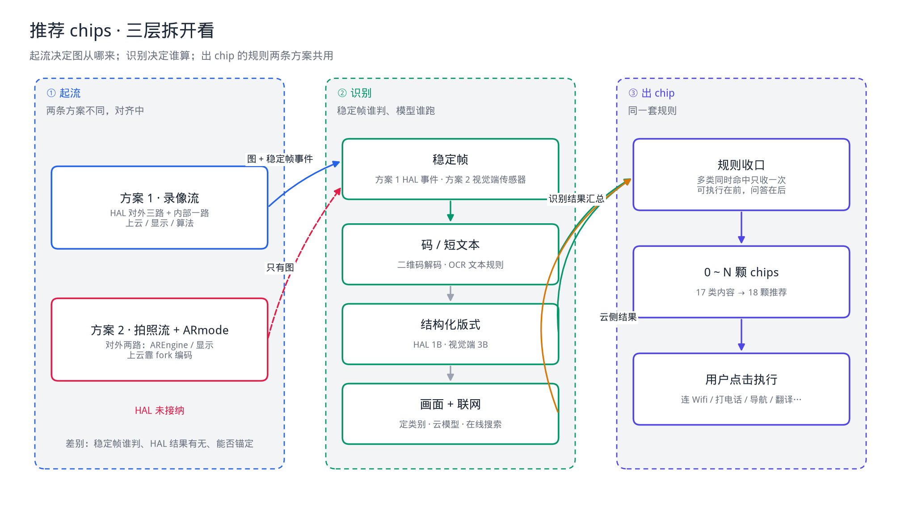
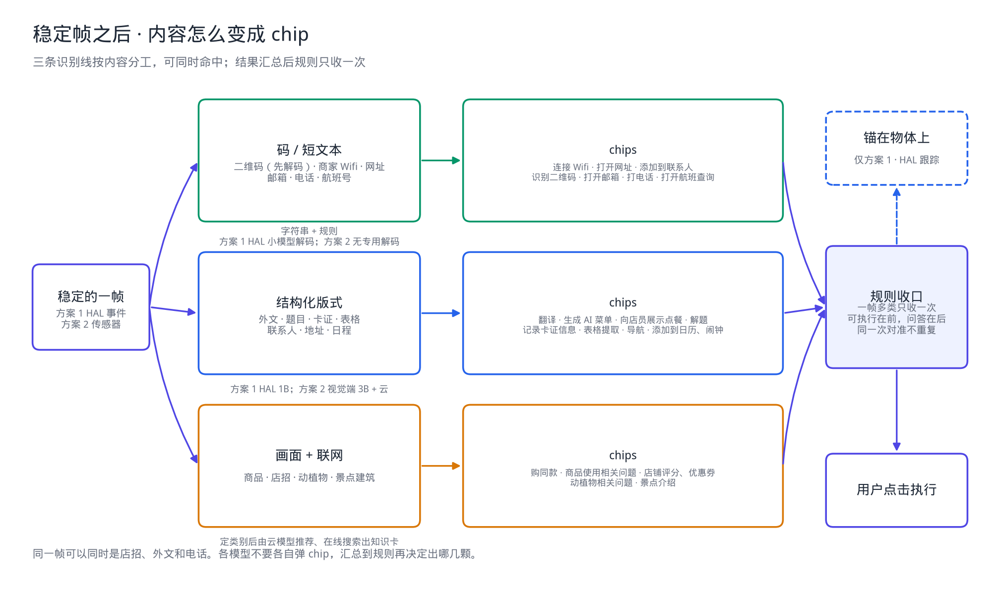
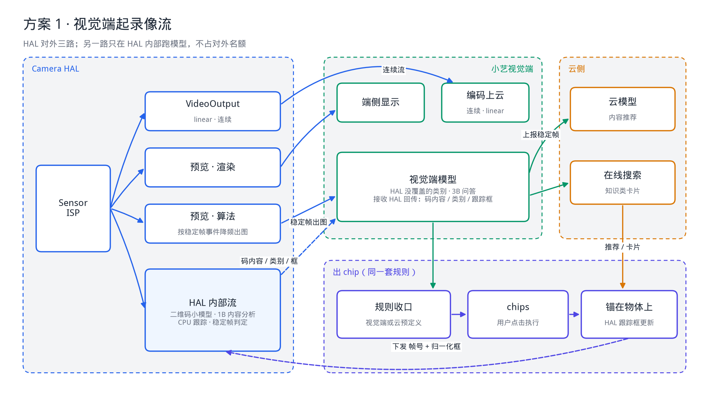
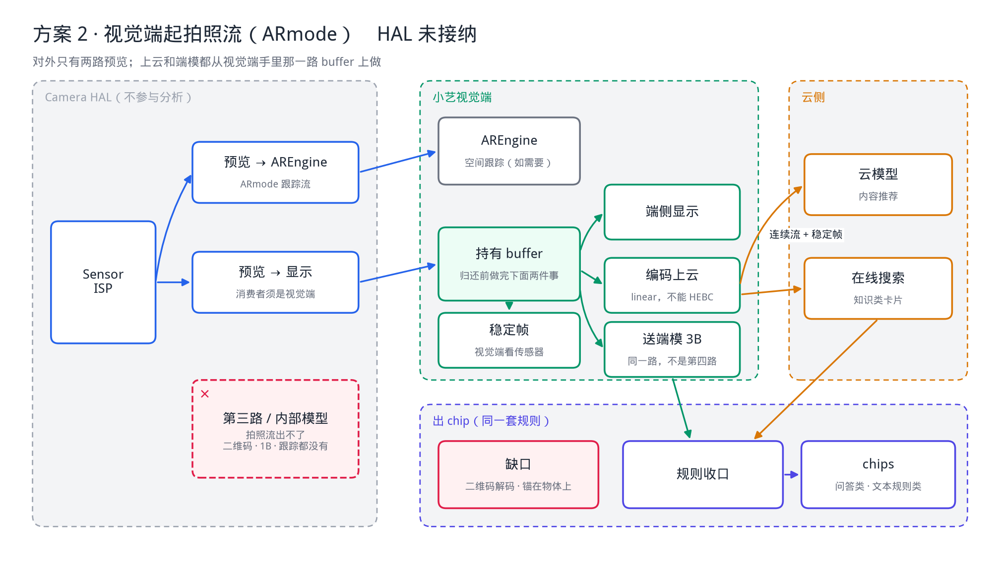

# 小艺视觉端 · 推荐 chips 方案

> 用途：把「起流 / 谁识别 / 出什么 chip」拆开，和 HAL、云侧对齐。  
> 状态：讨论稿。方案 1 在对齐；方案 2 HAL 未接纳。  
> 范围：小艺视觉端（原相机小艺 Tab）的内容推荐 chips。不含拍摄取片、深度。

---

## 0. 三层分开看



信息乱，是因为三层叠在一张图上。

| 层 | 决定什么 | 两条方案是否相同 |
|---|---|---|
| 起流 | 图从哪来、上云编码谁出、HAL 出几路 | 不同，还在对齐 |
| 识别 | 稳定帧谁判、二维码 / 类别 / 跟踪谁算 | 不同 |
| 出 chip | 识别到的类别映射成哪颗推荐 | 相同 |

出 chip 只看内容类别和抽出来的文本，不看这次是录像流还是拍照流。

---

## 1. 出 chip 的共同流程



```text
稳定的一帧
    │
    ├─► 识别（可多类同时命中）
    │     码 / 短文本 ── 规则
    │     卡证表格题目外文等 ── 版式 + 模型
    │     商品店招动植物景点 ── 模型 + 云侧搜索
    │
    ▼
规则收口（视觉端或云上的预定义规则，只收一次）
    │
    ▼
0～N 颗 chips    用户点击才执行
    │
    └─► 仅方案 1：把这一帧的帧号和框交给 HAL，chip 锚在物体上
```

一帧可以同时是店招、外文和电话。各模型不要各自弹 chip，结果汇总后再由规则决定出哪几颗。

建议（待拍板）：能直接执行的放前面，例如识别二维码、打电话、打开网址、导航、连接 Wifi；问答和知识卡放后面。同一次对准里，同一颗 chip 不重复弹。

上云编码和云侧分析是两件事：

- 编码上云是连续流（方案 1 的 VideoOutput，方案 2 的 fork 编码）。
- 内容推荐和在线搜索由稳定帧触发，不是每帧都分析。
- 云侧用的那张图还要对齐：用编码流里的同一帧号，还是算法路另传一张稳定帧。

---

## 2. 内容 → chip

17 类内容。商品同时对应「购同款」和「商品使用相关问题」，外文、日程、店招也是一内容多颗 chip。

### 2.1 码和短文本

抽到字符串就能定，不必为了出 chip 再跑一遍大模型。二维码先解码，再按内容落到更具体的那颗，而不是一律出「识别二维码」。

| 识别到的内容 | chip | 方案 1 | 方案 2 |
|---|---|---|---|
| 二维码，内容是 Wifi | 连接 Wifi | HAL 小模型解码 | 无专用解码，见下 |
| 二维码，内容是网址 | 打开网址 | HAL 小模型解码 | 无专用解码 |
| 二维码，内容是联系人 | 添加到联系人 | HAL 小模型解码 | 无专用解码 |
| 二维码，其他或解不出 | 识别二维码 | HAL 小模型 | 无专用解码 |
| 画面上的商家 Wifi | 连接 Wifi | 文本规则 | 文本从 3B / 云来 |
| 网址 | 打开网址 | 文本规则 | 同上 |
| 邮箱 | 打开邮箱 | 文本规则 | 同上 |
| 电话 | 打电话 | 文本规则 | 同上 |
| 航班号 | 打开航班查询 | 文本规则 | 同上 |

方案 2 的缺口在二维码解码。视觉端可以调 3B 出问答类 chips，但「图里有一个码」和「把码内容解出来」不是一回事。小艺没有二维码小模型，这颗 chip 依赖 HAL。退路是 1B / 3B 看图，解出内容没有把握。Wifi、网址、电话若是普通文字而不是码，方案 2 仍可由 OCR 文本加规则出。

### 2.2 结构化内容

要 OCR 和版式，方案 1 用 HAL 的 1B（视觉端不必对同一帧再跑一遍同类模型），方案 2 用视觉端 3B 和云分发。

| 内容 | chips |
|---|---|
| 外文 | 翻译。能看出是菜单时再加：生成 AI 菜单、向店员展示点餐 |
| 题目 | 解题 |
| 卡证 | 记录卡证信息 |
| 表格 | 表格提取 |
| 联系人 | 添加到联系人 |
| 地址 | 导航 |
| 日程 | 添加到日历、闹钟 |

### 2.3 要认画面，并联网

两条方案都把稳定帧交给云侧：云模型做内容推荐，在线搜索出知识类卡片。方案 1 可以先用 HAL 1B 给出类别，云只补知识和搜索；方案 2 类别也由视觉端 3B 或云来出。

| 内容 | chips |
|---|---|
| 商品 | 购同款、商品使用相关问题 |
| 店招 | 店铺评分、优惠券 |
| 动植物 | 动植物相关问题 |
| 景点建筑 | 景点介绍 |

---

## 3. 方案 1：视觉端起录像流

HAL 对外三路，另有一路只在 HAL 内部使用，不占对外名额。



```text
视觉端起录像流
    │
    ├─ VideoOutput ─────────► 编码上云（连续，linear）
    ├─ 预览 · 渲染 ─────────► 端侧显示
    ├─ 预览 · 算法 ─────────► 按稳定帧降频出图
    │                         ├─ 视觉端模型（HAL 没覆盖的类别）
    │                         └─ 上报稳定帧到云（云模型 + 在线搜索）
    │
    └─ HAL 内部流 ──────────► 二维码、1B 内容分析、跟踪
                              结果回传视觉端，进入同一套规则
```

稳定帧由 HAL 出事件。算法那路预览按事件出图，不按预览帧率把每帧都送去模型。

跟踪不另外起流。视觉端在出 chip 时，把 HAL 打在这帧上的时间戳和归一化框（左、上、宽、高，0～1）交给 HAL，HAL 用内部的 CPU 跟踪把框更新回去，chip 锚在物体上。识别返回时那一帧通常已经还掉了；握稳期间用这个框从当前帧开始跟。`globalMotionState` 离开脚架 / 手持稳定后，这次跟踪作废。

---

## 4. 方案 2：视觉端起拍照流（HAL 未接纳）

按 AREngine 的 ARmode 起拍照流。HAL 对外只有两路：一路预览给 AREngine，一路预览给端侧显示。没有 HAL 内部模型，也没有 HAL 稳定帧事件。



```text
视觉端起拍照流（ARmode）
    ├─ 预览 ──► AREngine
    └─ 预览 ──► 端侧显示
                │
                └─ 只有这一路的消费者是视觉端时
                   归还 buffer 之前：送端模、编码上云
```

上云不是 HAL 再出一路 VideoOutput，是视觉端从自己拿在手里的 buffer 上编码。显示若直接进渲染服务，视觉端不在队列上，这一路既不能编码上云，也不能送端模。

**不能再向 HAL fork 一路给端模。** 拍照流给不了「显示预览 + 上云录像 + 再一路算法」。端模要跑，只有两种接法：

- 显示预览的消费者就是视觉端：端模和上云编码共用这一路，在归还 buffer 之前做完。这不是第四路输出。
- 显示预览进了渲染服务：只有 AREngine 还握着图。端模要图，就得 AREngine 把帧交出来。

HAL 不参与之后，后面的流程和方案 1 的规则层相同，只是输入变了：

- 稳定帧由视觉端按传感器自己判。
- 调度视觉端 HiAI。3B 用来出问答类 chips（解题、翻译、动植物和商品相关问题等）。
- 稳定帧送到云分发：云模型做内容推荐，在线搜索出知识卡。
- 拿不到 HAL 的二维码解码、1B 类别和跟踪框。chip 不能锚在物体上。

---

## 5. 两条方案对照

| | 方案 1 录像流 | 方案 2 拍照流 + ARmode |
|---|---|---|
| 状态 | 对齐中 | HAL 未接纳 |
| 对外出流 | VideoOutput + 显示预览 + 算法预览 | 显示预览 + AREngine 预览。上云是 fork 编码 |
| 稳定帧 | HAL 事件，算法预览按事件出图 | 视觉端看传感器 |
| 二维码 | HAL 小模型，解出内容再映射 chip | 缺口。退路是 1B / 3B 看图 |
| 版式类（卡证、表格、题目、外文等） | HAL 1B | 视觉端 3B + 云 |
| 商品、店招、动植物、景点 | HAL 1B 定类别，云补搜索和知识卡 | 视觉端 3B 或云定类别，云补搜索和知识卡 |
| chip 锚在物体上 | HAL 内部跟踪 | 没有 |
| 出 chip 的规则 | 同一套 | 同一套 |

---

## 6. 待对齐

1. 云侧分析用编码流里的同一帧号，还是算法路另传一张稳定帧。
2. 方案 1 三路的分辨率和帧率；算法路是否只在稳定帧出图。
3. HAL 回传的字段：二维码内容、1B 类别、跟踪框；帧号是否与预览同一套时间戳。
4. 方案 2 里，显示预览的消费者是视觉端还是渲染服务。这决定端模和上云有没有图。
5. 方案 2 的二维码是否接受「无专用解码」这条降级。
6. 一帧多类时出几颗、什么顺序。商品的「购同款」和「使用问题」是否同时出。
